------------------------------------------------------------------------

# Solutions for experimental research

When I think something can be changed or improved, I make it my mission to redesign or build tools and protocols that can make our lab workflow more efficient and standard, for repeatable outcomes.

> **Can this be redesigned?**

Here I want to share some of mine and my labs favorite designs.

------------------------------------------------------------------------

# Reusable light shields for plant symbiosis assays

## The problem

Plant symbiosis experiments are a big part of our research. *Medicago–Sinorhizobium* symbiosis experiments require plants to grow in transparent tubes while the developing root system stays protected from light.

For years our lab used aluminum foil molds. I found this difficult to use because it required repeated preparation and caution not to rip or fold the fragile paper. This also produced waste and allowed for variability in how completely each root zone was covered.

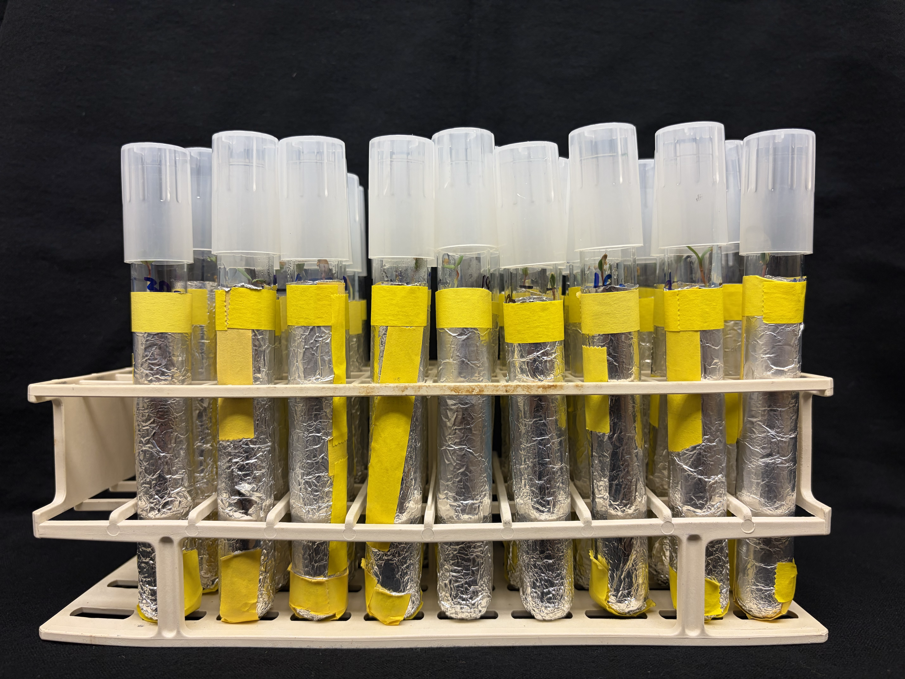{.engineering-image}

## The solution

I designed reusable opaque sleeves that fit around our plant-growth tubes and provide consistent light protection that can be quickly removed and replaced during experimental observations.

```{=html}
<div class="model-container">

<model-viewer
  src="models/11mm_sleeve_graphite.glb"
  alt="Interactive 3D model of the reusable plant growth tube sleeve"

  camera-controls
  touch-action="pan-y"

  camera-orbit="35deg 65deg 180%"

  min-camera-orbit="auto 0deg 5%"
  max-camera-orbit="auto 180deg 1000%"

  min-field-of-view="1deg"
  max-field-of-view="100deg"

  orbit-sensitivity="1.2"
  zoom-sensitivity="1.5"
  pan-sensitivity="1.4"

  auto-rotate
  auto-rotate-delay="4000"
  rotation-per-second="12deg"

  shadow-intensity="1"
  exposure="1"
  interaction-prompt="auto">

</model-viewer>

<p class="model-caption">
<strong>Interactive 3D model.</strong>
Left-drag to rotate · Right-drag to pan · Scroll to zoom
</p>

</div>
```

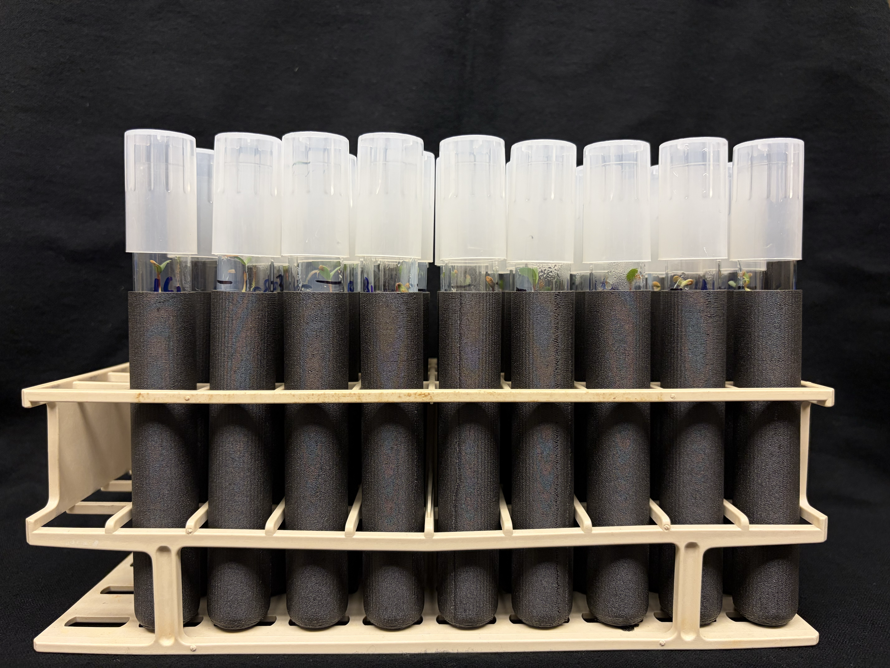{.engineering-image}

# Reusable Petri dish division template

## The problem

Some microbiological procedures require Petri dishes to be divided into equal regions. Drawing these divisions manually can introduce small differences in positioning and requires repeated careful measurement for every plate.

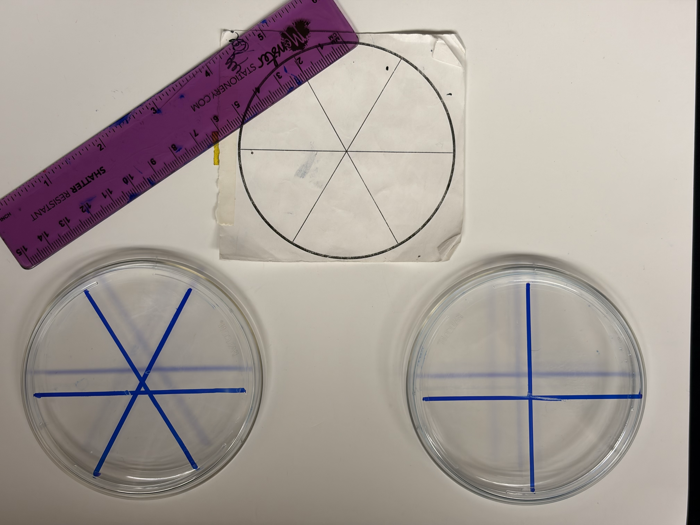{.engineering-image}

## The solution

I designed reusable 3D-printed templates that align with the Petri dish and guide equal plate division.

This design includes reference features for multiple plate layouts, allowing the same tool to be used for different experimental configurations.

::: model-container
```{=html}
<model-viewer
  src="models/6way_petri_template_graphite.glb"
  alt="Interactive 3D model of the 6-way Petri dish division template"

  camera-controls
  touch-action="pan-y"

  camera-orbit="30deg 35deg 170%"

  min-camera-orbit="auto 5deg 10%"
  max-camera-orbit="auto 175deg 1000%"

  min-field-of-view="1deg"
  max-field-of-view="100deg"

  auto-rotate
  auto-rotate-delay="4000"
  rotation-per-second="10deg"

  shadow-intensity="1"
  exposure="1"
  interaction-prompt="auto">
```

</model-viewer>

<p class="model-caption">

<strong>Interactive 3D model -3 and 6- way template.</strong> Drag to rotate · Right-drag to pan · Scroll to zoom

</p>
:::

::: {layout-ncol="2"}
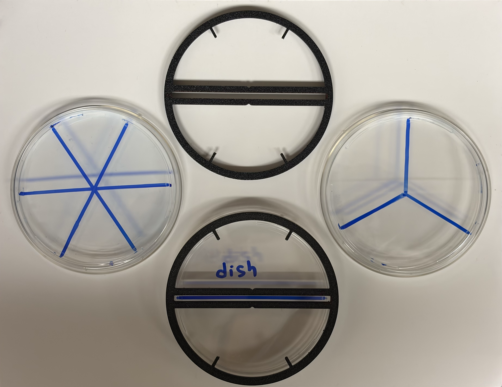{.engineering-image}

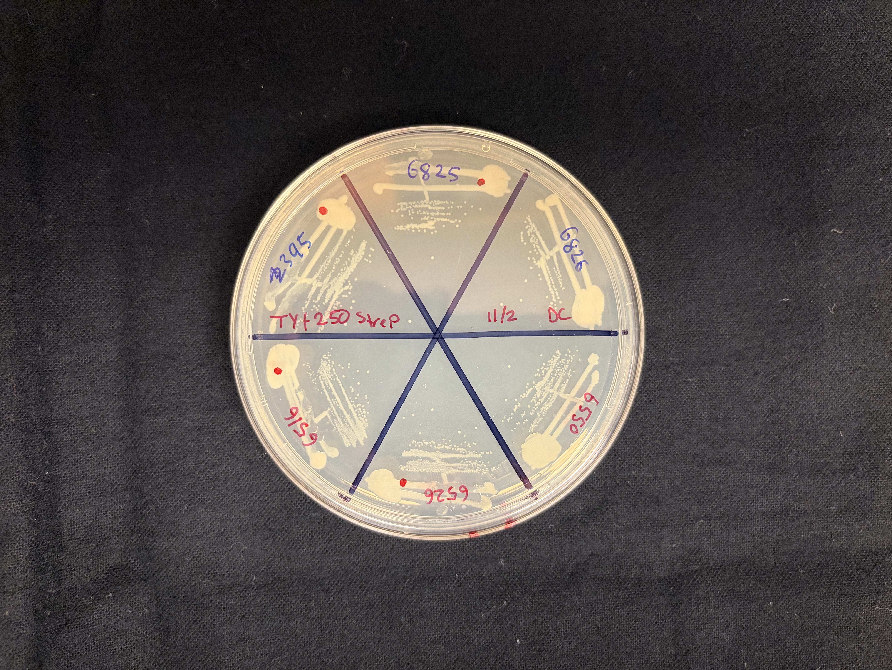{.engineering-image}
:::

::: model-container
```{=html}
<model-viewer
  src="models/8way_petri_template_graphite.glb"
  alt="Interactive 3D model of the 8-way Petri dish division template"

  camera-controls
  touch-action="pan-y"

  camera-orbit="30deg 35deg 170%"

  min-camera-orbit="auto 5deg 10%"
  max-camera-orbit="auto 175deg 1000%"

  min-field-of-view="1deg"
  max-field-of-view="100deg"

  auto-rotate
  auto-rotate-delay="4000"
  rotation-per-second="10deg"

  shadow-intensity="1"
  exposure="1"
  interaction-prompt="auto">
```

</model-viewer>

<p class="model-caption">

<strong>Interactive 3D model - 4 and 8 -way template.</strong> Drag to rotate · Right-drag to pan · Scroll to zoom

</p>
:::

# Spectrophotometer component redesign

## The problem

A structural component of a Thermo Scientific GENESYS spectrophotometer sample-compartment lid failed near the hinge assembly.

Rather than replacing the entire assembly, I reversed engineered, redesigned and fabricated the damaged component in house.

```{=html}
<div class="image-carousel" id="old-lid-carousel">

<div class="carousel-viewport">
<div class="carousel-track">

<div class="carousel-slide">
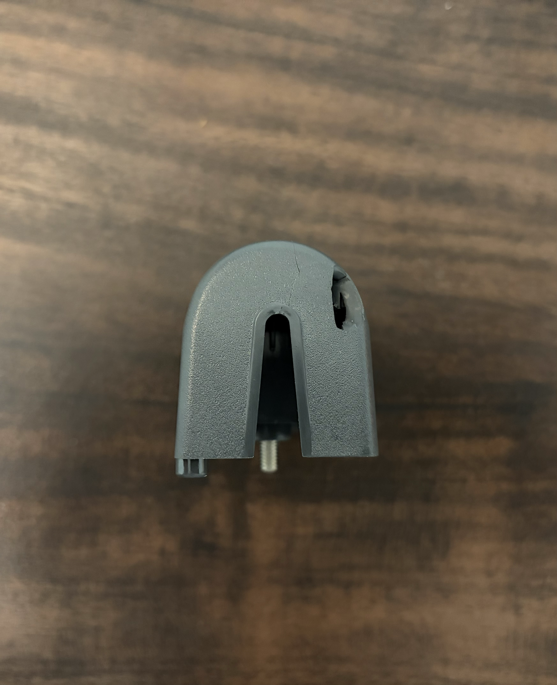
</div>

<div class="carousel-slide">
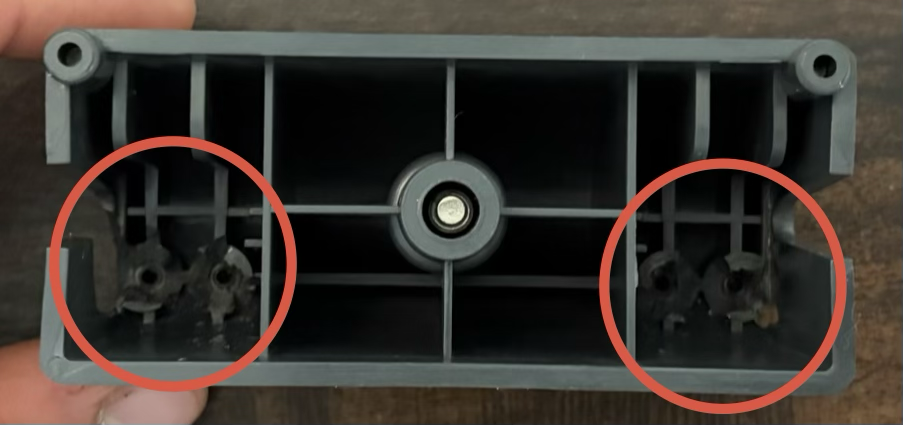
</div>

<div class="carousel-slide">
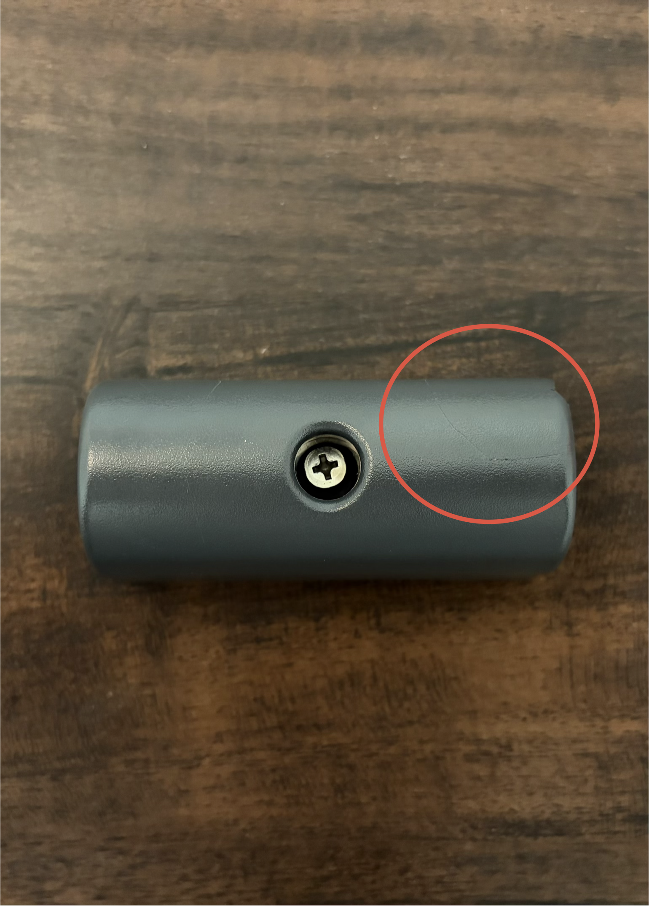
</div>

<div class="carousel-slide">
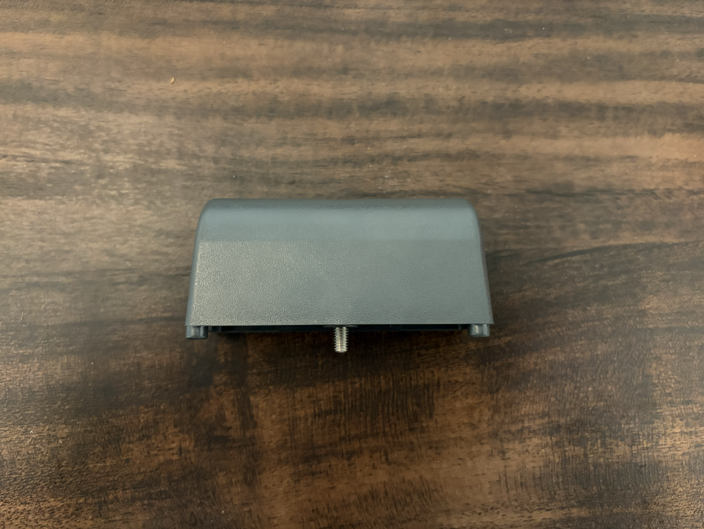
</div>

</div>
</div>

<button class="carousel-arrow carousel-prev" aria-label="Previous image">‹</button>
<button class="carousel-arrow carousel-next" aria-label="Next image">›</button>

<div class="carousel-dots">
<button class="carousel-dot active" aria-label="Image 1"></button>
<button class="carousel-dot" aria-label="Image 2"></button>
<button class="carousel-dot" aria-label="Image 3"></button>
<button class="carousel-dot" aria-label="Image 4"></button>
</div>

<p class="engineering-carousel-caption">
<strong>Original component.</strong> Multiple views of the damaged hinge base component I used to reverse engineer the replacement.Primary failure seen in the hinge attachment design. Redesigned in the new component.
</p>

</div>

<script>
(() => {
  const carousel = document.querySelector("#old-lid-carousel");
  if (!carousel) return;

  const track = carousel.querySelector(".carousel-track");
  const slides = carousel.querySelectorAll(".carousel-slide");
  const dots = carousel.querySelectorAll(".carousel-dot");
  const prev = carousel.querySelector(".carousel-prev");
  const next = carousel.querySelector(".carousel-next");

  let current = 0;

  function updateCarousel() {
    track.style.transform = `translateX(-${current * 100}%)`;

    dots.forEach((dot, index) => {
      dot.classList.toggle("active", index === current);
    });
  }

  prev.addEventListener("click", () => {
    current = (current - 1 + slides.length) % slides.length;
    updateCarousel();
  });

  next.addEventListener("click", () => {
    current = (current + 1) % slides.length;
    updateCarousel();
  });

  dots.forEach((dot, index) => {
    dot.addEventListener("click", () => {
      current = index;
      updateCarousel();
    });
  });

  updateCarousel();
})();
</script>
```

## The design process

I measured the original, reconstructed the component in CAD, and modified the design to accommodate the existing hinge and new hardware.

The redesign included changes to the walls, fastener placement and type, hinge alignment, and reinforcement around mechanically stressed regions.

::: model-container
```{=html}
<model-viewer
  src="models/GENESYS140_hinge_base_graphite.glb"
  alt="Interactive 3D model of the redesigned GENESYS 140 hinge-base component"

  camera-controls
  touch-action="pan-y"

  camera-orbit="35deg 70deg 180%"

  min-camera-orbit="auto 5deg 10%"
  max-camera-orbit="auto 175deg 1000%"

  min-field-of-view="1deg"
  max-field-of-view="100deg"

  auto-rotate
  auto-rotate-delay="4000"
  rotation-per-second="10deg"

  shadow-intensity="1"
  exposure="1"
  interaction-prompt="auto">
```

</model-viewer>

<p class="model-caption">

<strong>Interactive 3D model.</strong> Redesigned hinge-base component developed from measurements of the original part. Drag to rotate · Right-drag to pan · Scroll to zoom.

</p>
:::

```{=html}
<div class="image-carousel" id="working-lid-carousel">

<div class="carousel-viewport">
<div class="carousel-track">

<div class="carousel-slide">
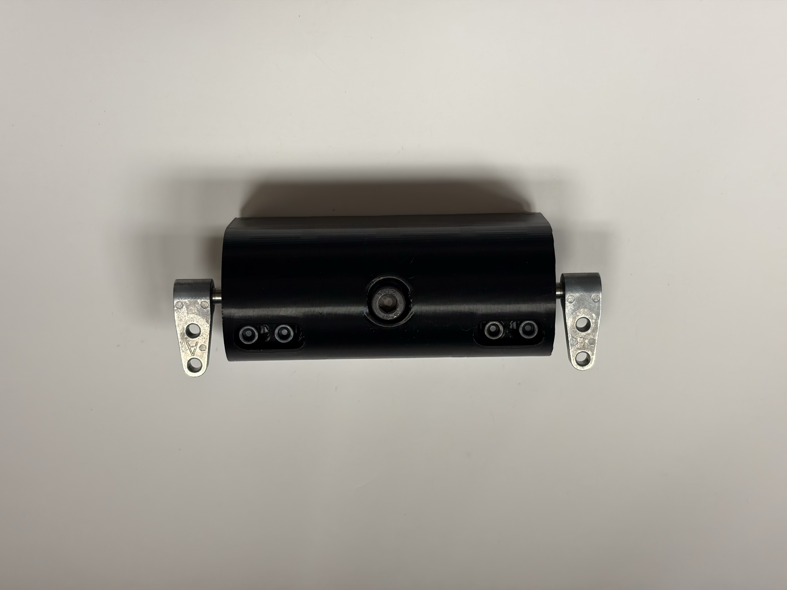
</div>

<div class="carousel-slide">
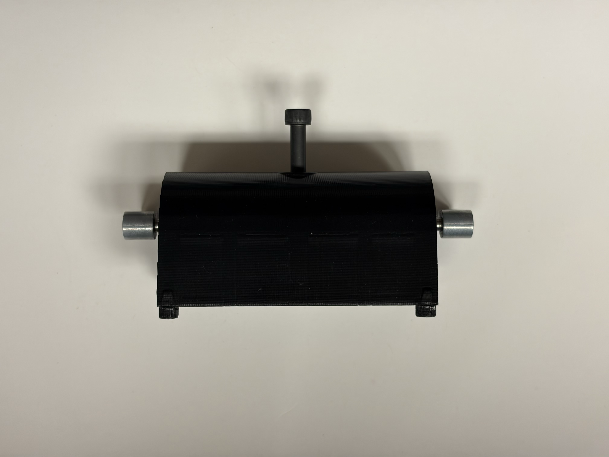
</div>

<div class="carousel-slide">
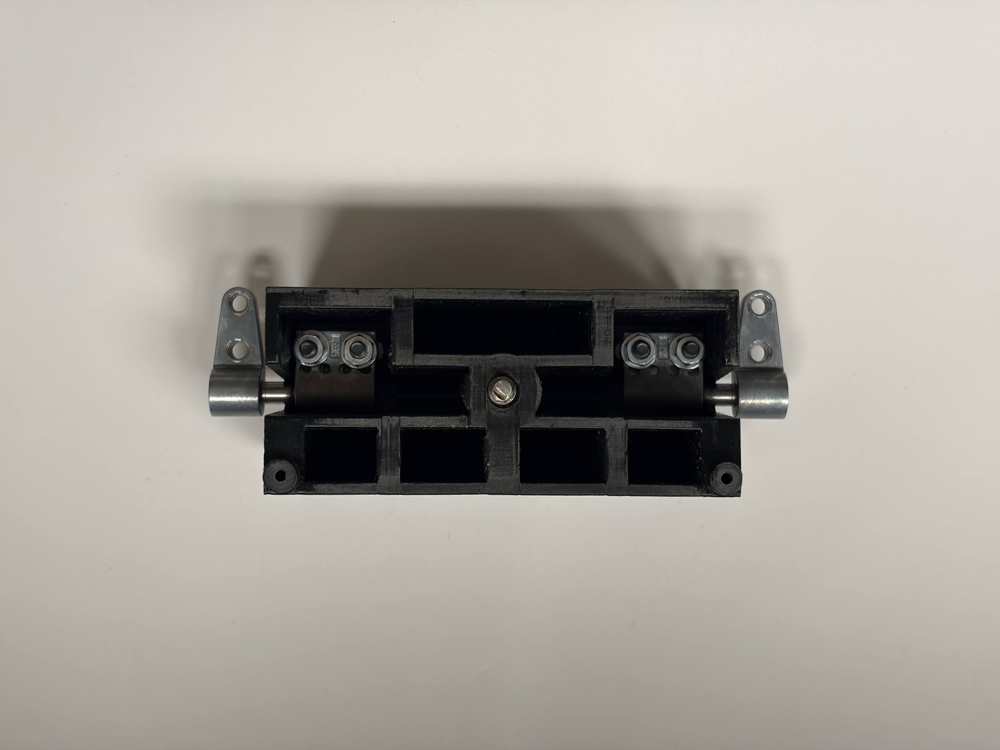
</div>

<div class="carousel-slide">
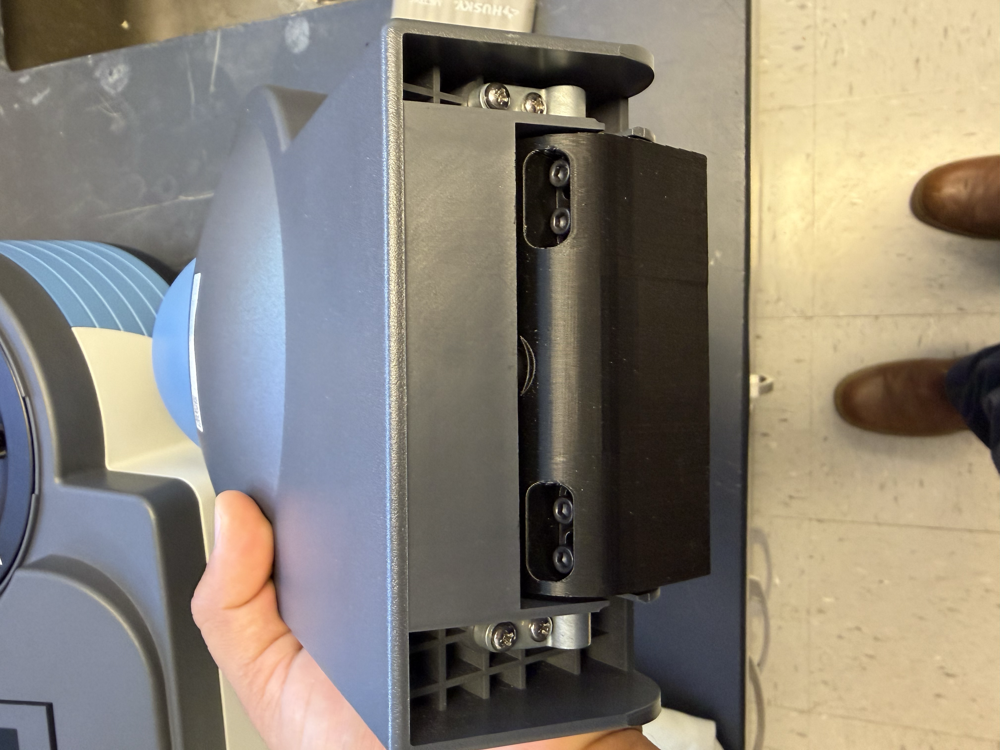
</div>

<div class="carousel-slide">
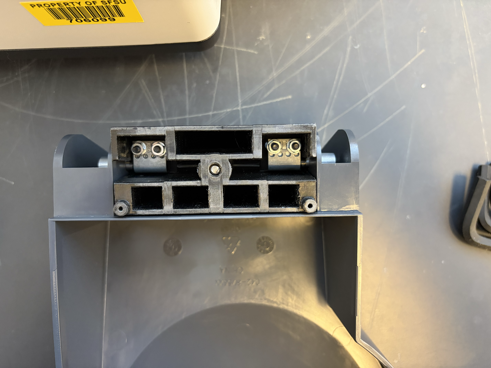
</div>

<div class="carousel-slide">
<video controls playsinline preload="metadata">
  <source src="images/working_lidvid.mp4" type="video/mp4">
  Your browser does not support embedded video.
</video>
</div>

</div>
</div>

<button class="carousel-arrow carousel-prev" aria-label="Previous image">‹</button>
<button class="carousel-arrow carousel-next" aria-label="Next image">›</button>

<div class="carousel-dots">
<button class="carousel-dot active" aria-label="Image 1"></button>
<button class="carousel-dot" aria-label="Image 2"></button>
<button class="carousel-dot" aria-label="Image 3"></button>
<button class="carousel-dot" aria-label="Image 4"></button>
<button class="carousel-dot" aria-label="Image 5"></button>
<button class="carousel-dot" aria-label="Video 6"></button>
</div>

<p class="engineering-carousel-caption">
<strong>Fabrication and implementation.</strong> images of the completed replacement component, its installation in our GENESYS 140 machine, and a video showing its functionality. For our lab working even better than before. 
</p>

</div>

<script>
(() => {
  const carousel = document.querySelector("#working-lid-carousel");
  if (!carousel) return;

  const track = carousel.querySelector(".carousel-track");
  const slides = carousel.querySelectorAll(".carousel-slide");
  const dots = carousel.querySelectorAll(".carousel-dot");
  const prev = carousel.querySelector(".carousel-prev");
  const next = carousel.querySelector(".carousel-next");
  const videos = carousel.querySelectorAll("video");

  let current = 0;

  function updateCarousel() {
    track.style.transform = `translateX(-${current * 100}%)`;

    dots.forEach((dot, index) => {
      dot.classList.toggle("active", index === current);
    });

    videos.forEach(video => video.pause());
  }

  prev.addEventListener("click", () => {
    current = (current - 1 + slides.length) % slides.length;
    updateCarousel();
  });

  next.addEventListener("click", () => {
    current = (current + 1) % slides.length;
    updateCarousel();
  });

  dots.forEach((dot, index) => {
    dot.addEventListener("click", () => {
      current = index;
      updateCarousel();
    });
  });

  updateCarousel();
})();
</script>
```

**This project demonstrates how reverse engineering and prototyping can extend the life of laboratory equipment when an existing design can be improved.**

------------------------------------------------------------------------

# Improving chlorophyll sample preparation

## The problem

My symbiosis experiments require chlorophyll extraction from plant tissue as an endpoint measurement of plant performance.

Manual tissue disruption can be repetitive and may introduce variability in extraction efficiency between samples, particularly when processing larger experiments.

## Current development

I am developing a bead-based tissue disruption device intended to improve the speed and consistency of chlorophyll sample preparation.

The project is currently focused on designing a system that can process samples reproducibly while integrating with the existing extraction workflow.

**images coming soon**

## Research goal

Rather than changing the biological assay itself, the objective is to improve the **sample processing step** that precedes measurement.

> **Design goal:** Increase throughput and standardize tissue disruption during chlorophyll extraction.

------------------------------------------------------------------------

# Building an in house plant resource

Engineering a research workflow does not always require building a physical device.

## The problem

### The problem: aging seed stocks

Our existing *Medicago truncatula* seed lab-line stocks are more than 20 years old, cannot be bought and average about **2% germination**. This creates a major bottleneck when preparing plants for symbiosis experiments.

Seeds aren't just placed into incubation. Before germination, they undergo a multi-step sterilization and washing procedure that takes approximately **5–6 hours**, followed by incubation and screening for contamination before seedlings can be used experimentally.

At a 2% germination rate, processing **1,500 seeds may yield only about 30 seedlings**. Obtaining enough plants for a single symbiosis experiment can therefore require processing several thousand seeds, sometimes the equivalent of six or more 1,500 seed batches.

When germination is insufficient, additional batches must be prepared. This not only increases labor and material use, but can also result in seedlings germinating on different days, making it more difficult to establish a synchronized experimental cohort.These are from a special lab strain seed stock and cannot be bought.\
\

{.engineering-image}

::: callout-note
### What 2% germination means

**1,500 seeds processed → \~30 germinated seedlings**

To obtain roughly 150–180 seedlings, thousands of seeds may need to be sterilized, washed, incubated, and screened for contamination.
:::

## The approach

I developed an in-house seed-bulking workflow for *M. truncatula* and other experimental legumes. This has never been done in our lab and required me to learn about greenhouse plant production from the ground up. I had to learn about unfamiliar things such as substrate types, waterings, nutrition, light, and plant support. Our current plants are as healthy as they can be

This reflects an important part of how I approach research: when I encounter a problem outside my previous experience, I am willing to learn the system and refine the process until it works.

::: {layout-ncol="2"}
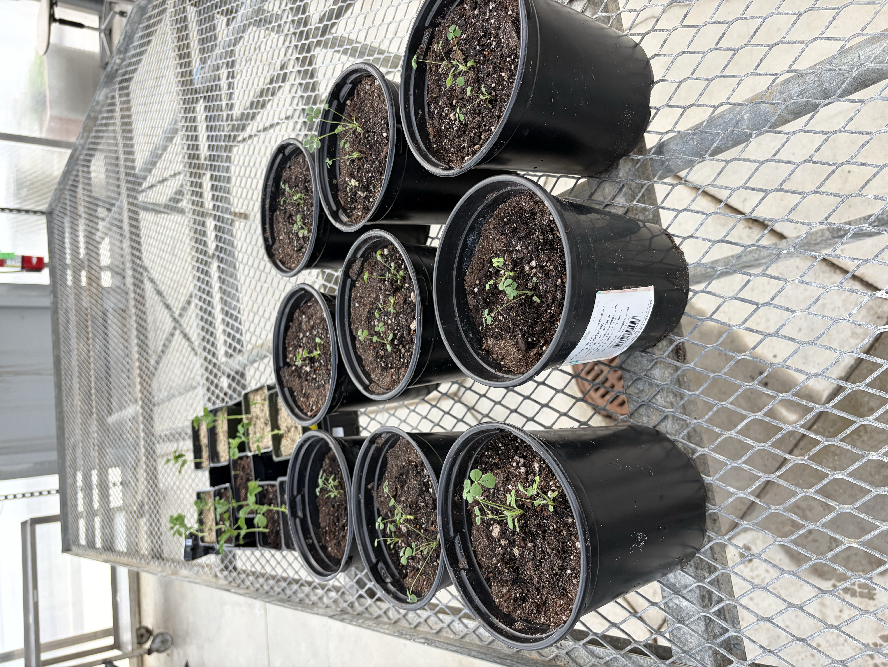{.engineering-pair-image}

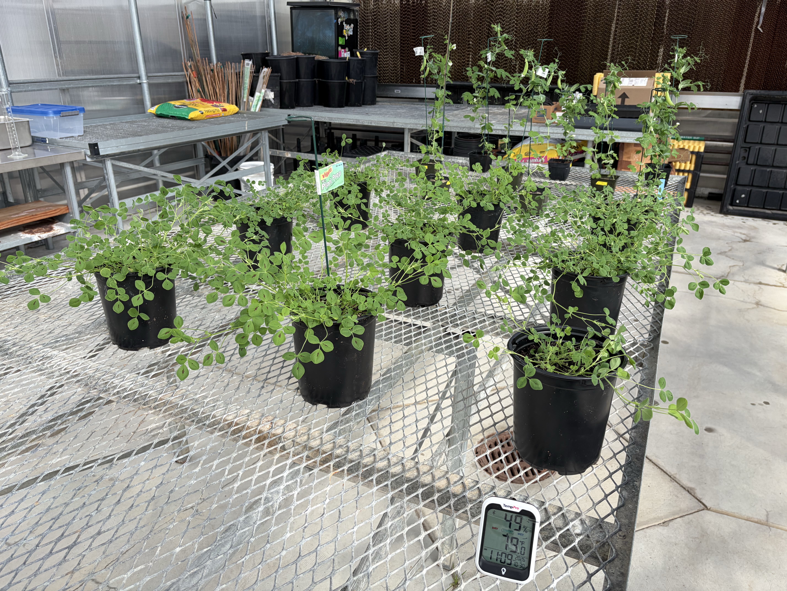{.engineering-pair-image}
:::

## Research benefit

Developing an internal seed supply preserves access to our specialized *Medicago truncatula* Jemalong A17 line, which is not commercially available and provides a reliable source of experimental hosts for future symbiosis studies.

------------------------------------------------------------------------

# A common approach

Although these projects address very different problems, I approach them using the same general process:

**Identify a limitation → understand the constraints → design a solution → prototype → test → refine → implement**

This approach comes directly from my experience working across engineering, fabrication, entrepreneurship, and biological research.

For me, research engineering is not separate from doing science. It is another way of asking how an experimental system can be better understood.
