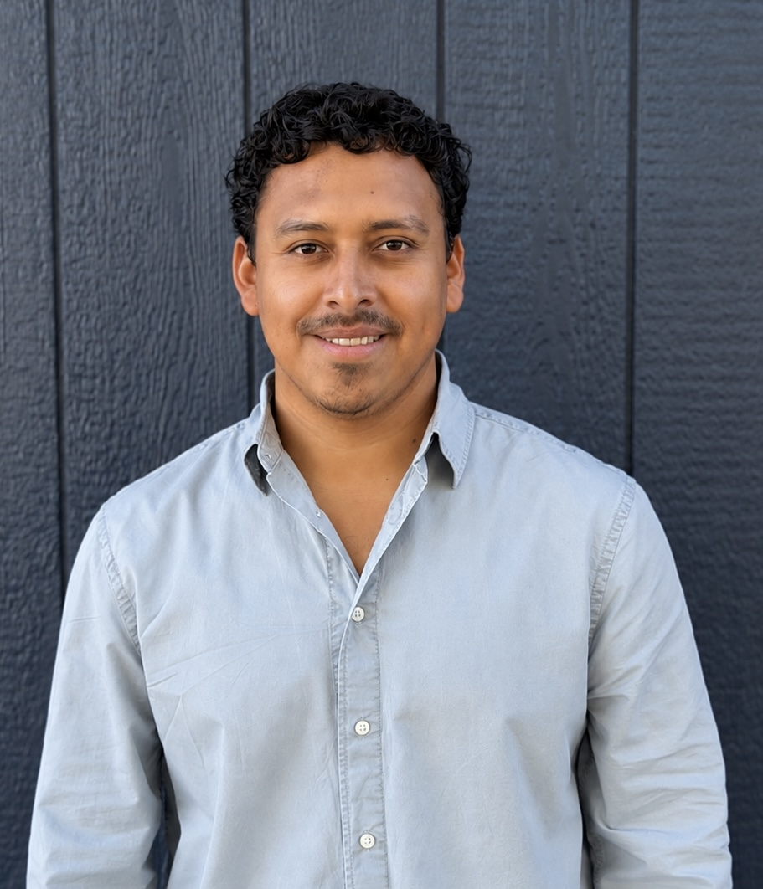

::::: hero
::: hero-text
# Denis Cruz - in the Chen Lab)

## Cell & Molecular Biology · Microbial Genetics · Bioengineering

I am an M.S. researcher at San Francisco State University studying how bacterial genetics shapes interactions between microbes and their hosts.

My current research uses the *Sinorhizobium meliloti–Medicago* symbiosis as a model to investigate how bacterial pathways involved in surface behavior, cellular regulation, and RNA organization influence host colonization and the maintenance of effective symbiosis.

Alongside my biological research, I draw on experience in engineering, fabrication, data analysis, and entrepreneurship. In my lab I constantly seek to develop practical tools and approaches that improve how our research is performed.

[Explore My Research](research.qmd){.site-button} [View My CV](cv.qmd){.site-button .site-button-secondary}
:::

::: hero-photo
{.profile-photo}
:::
:::::

::::::: home-section
## Approach at research and problem solving

All my work in and out the lab is driven my determination to **understand the systems I work with, biological or not. Hard problems push us to generate better experiments, better tools, and eventually better technologies.**

:::::: home-grid
::: home-card
### 🧬 Research

Investigating genetic determinants of *Sinorhizobium meliloti* symbiotic performance in *Medicago* hosts, with particular interest in bacterial surface-associated behavior, regulatory pathways, and RNase E-dependent RNA organization.

[Explore Research →](research.qmd)
:::

::: home-card
### ⚙️ Research Engineering

I enjoy designing and prototyping tools that address practical limitations in our experimental workflows. From custom 3D-printed lab components and devices for improving sample preparation and standardization to developing an in house seed-bulking workflow.

[See Research Engineering →](engineering.qmd)
:::

::: home-card
### 🔧 Outside the Lab

My background in diesel systems, fabrication, and entrepreneurship shaped the way I approach scientific problems. I am interested in bringing that same problem-solving mindset into biotechnology and bioengineering.

[Outside the Lab →](outside-lab.qmd)
:::
::::::
:::::::

::: {.home-section .home-bottom}
## Current Focus

**M.S. Thesis:** *Genetic Determinants of Sinorhizobium meliloti Symbiotic Performance in Medicago Hosts*

Chen Laboratory · Department of Biology\
San Francisco State University
:::
