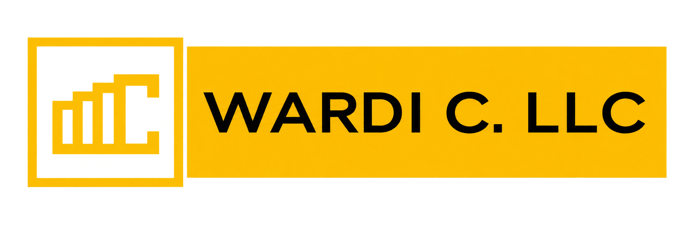
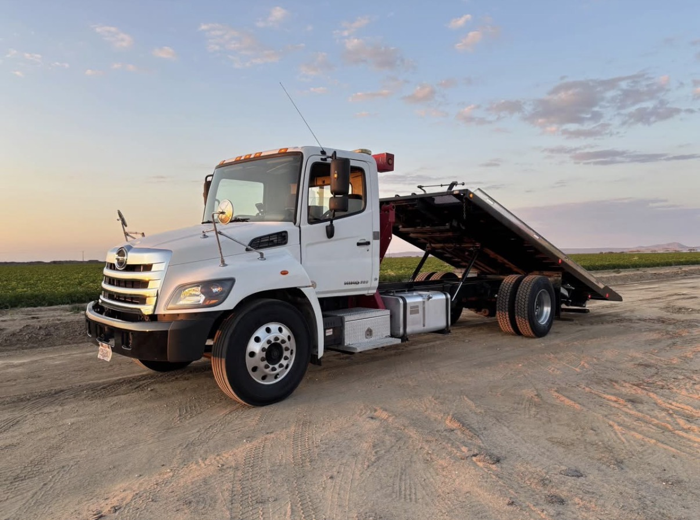
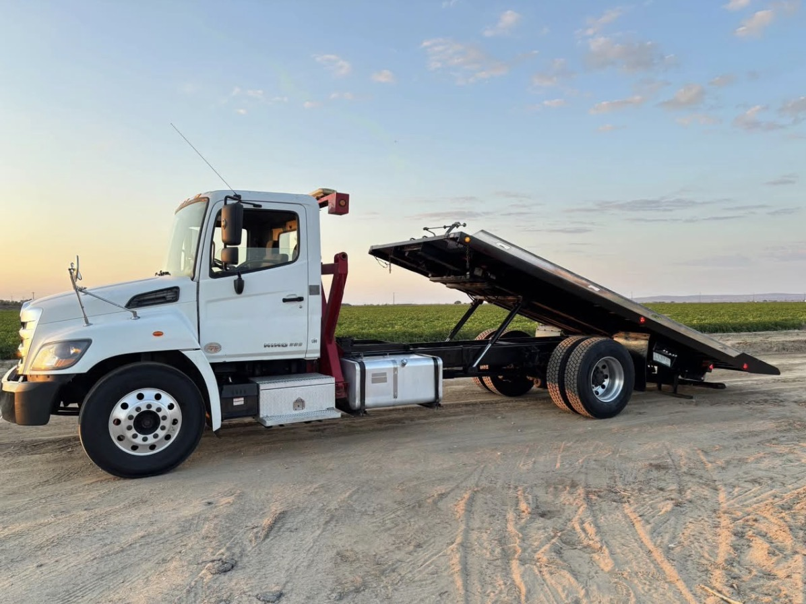
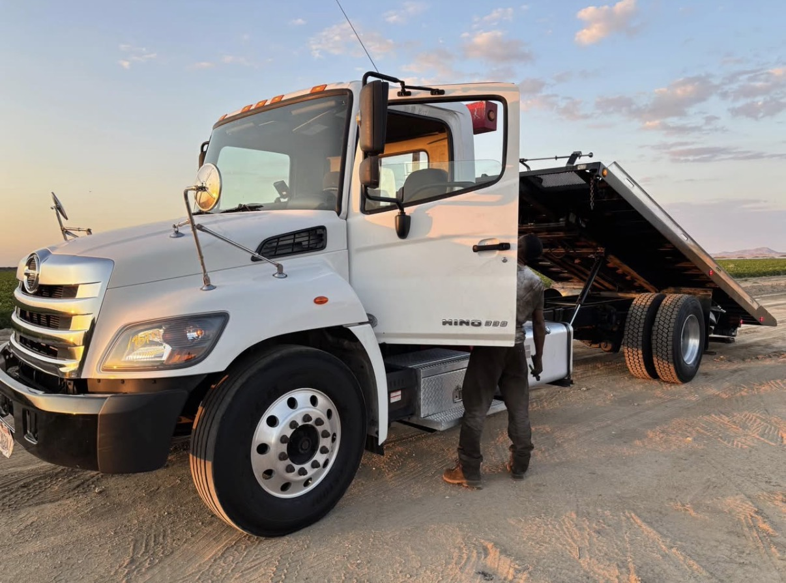
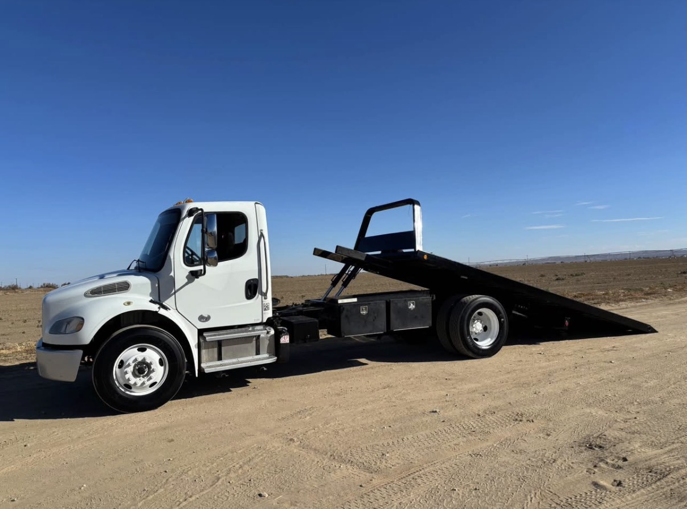
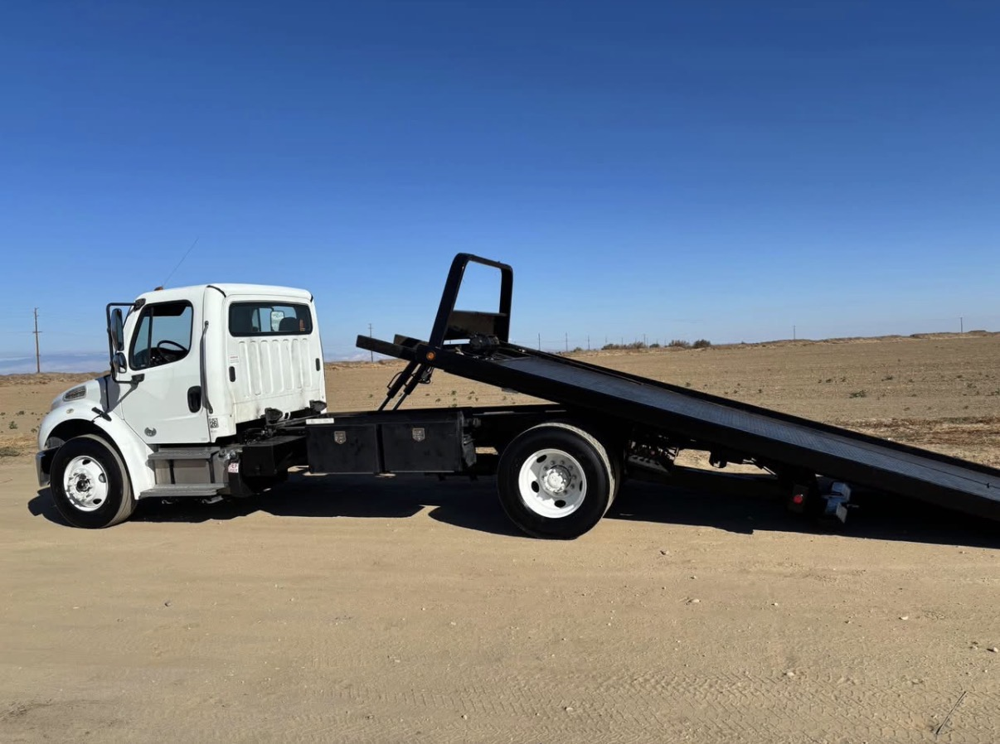

```{=html}
<div class="outside-brand-corners">

  <div class="outside-brand-left">
    
  </div>

  <div class="outside-brand-right">
    
  </div>

</div>
```

# Outside the Lab

Way before I entered a research laboratory, I was already learning by building.

I began working on machines and engine projects during high school, initially out of curiosity and necessity. Over time, those ideas became increasingly ambitious, and in 2020, at age 20, that work developed into a business, initially logistics, and now solely focused on diesel systems, fabrication, and custom tow truck builds.

Although I enjoyed building a business and working with mechanical systems, I chose to continue pursuing science not only because I love it but also because I believe I have a lot to bring to science. Whether I am developing a piece of lab equipment, troubleshooting an experiment, or turning an idea for a truck into a functioning mechanism, I approach problems the same way, **understand how the system works, identify what can be improved, and keep working until the idea becomes something real**

These projects are a reminder of what I bring to research beyond my technical training, **I take ownership of difficult problems, and do my best to carry ANY idea from concept through implementation\
**

```{=html}
<div class="image-carousel" id="truck-carousel">

<div class="carousel-viewport">
<div class="carousel-track">

<div class="carousel-slide">

</div>

<div class="carousel-slide">

</div>

<div class="carousel-slide">

</div>

<div class="carousel-slide">

</div>

<div class="carousel-slide">

</div>

</div>
</div>

<button class="carousel-arrow carousel-prev" aria-label="Previous image">‹</button>
<button class="carousel-arrow carousel-next" aria-label="Next image">›</button>

<div class="carousel-dots">
<button class="carousel-dot active" aria-label="Image 1"></button>
<button class="carousel-dot" aria-label="Image 2"></button>
<button class="carousel-dot" aria-label="Image 3"></button>
<button class="carousel-dot" aria-label="Image 4"></button>
<button class="carousel-dot" aria-label="Image 5"></button>
</div>

<p class="engineering-carousel-caption">
<strong>Selected builds.</strong> A few of photos showing the type of work my company does. These are frame to bed bed tow truck builds.
</p>

</div>

<script>
(() => {
  const carousel = document.querySelector("#truck-carousel");
  if (!carousel) return;

  const track = carousel.querySelector(".carousel-track");
  const slides = carousel.querySelectorAll(".carousel-slide");
  const dots = carousel.querySelectorAll(".carousel-dot");
  const prev = carousel.querySelector(".carousel-prev");
  const next = carousel.querySelector(".carousel-next");

  let current = 0;

  function updateCarousel() {
    track.style.transform = `translateX(-${current * 100}%)`;

    dots.forEach((dot, index) => {
      dot.classList.toggle("active", index === current);
    });
  }

  prev.addEventListener("click", () => {
    current = (current - 1 + slides.length) % slides.length;
    updateCarousel();
  });

  next.addEventListener("click", () => {
    current = (current + 1) % slides.length;
    updateCarousel();
  });

  dots.forEach((dot, index) => {
    dot.addEventListener("click", () => {
      current = index;
      updateCarousel();
    });
  });

  updateCarousel();
})();
</script>
```
