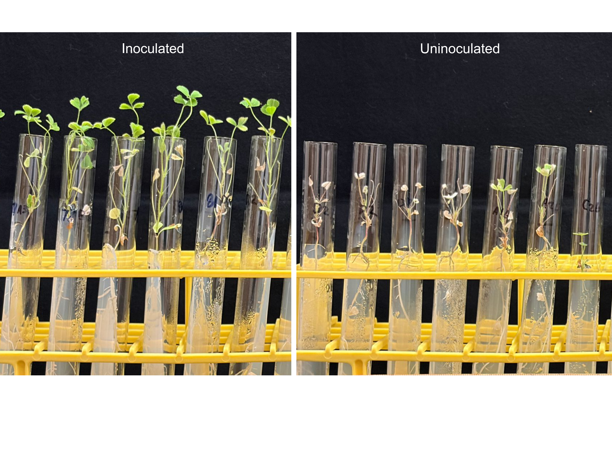
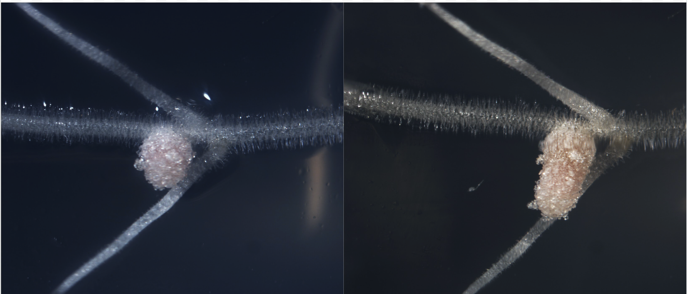
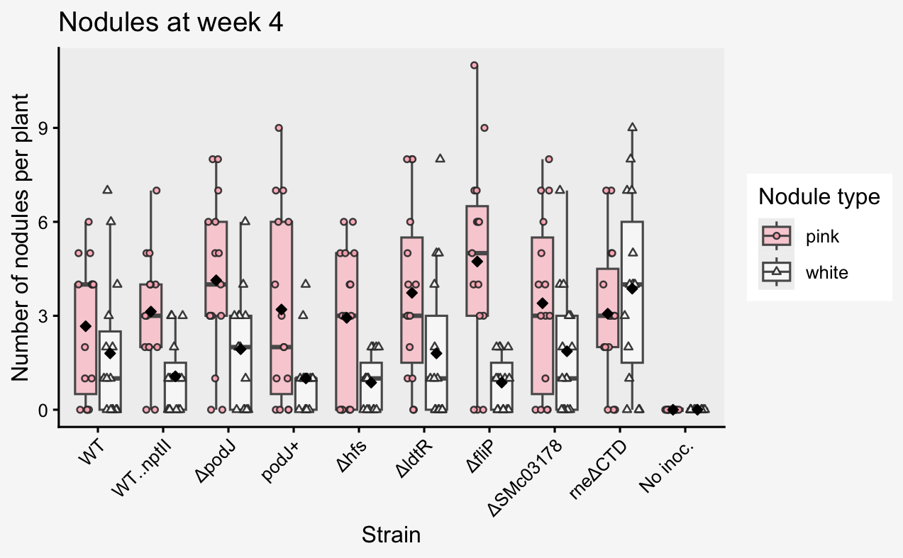
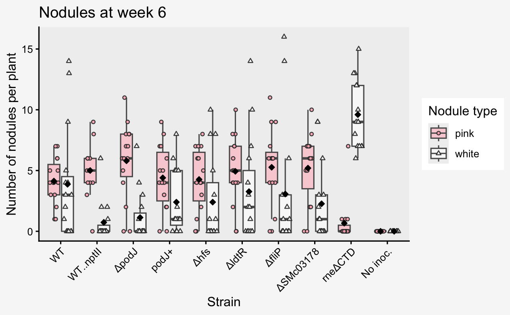

------------------------------------------------------------------------

# From bacterial genes to plant outcomes

My research asks how changes in bacterial genes and cellular behavior ultimately influence interactions with a host.

I study this question using the symbiosis between *Sinorhizobium meliloti* and *Medicago truncatula* - this system connects bacterial genetics ➡ host colonization ➡ plant performance.

> **My central question:** How do bacterial genes that influence attachment, biofilm formation, motility, and regulation affect the establishment and long-term maintenance of successful symbiosis?

------------------------------------------------------------------------

# Why study rhizobia?

Leguminous crops such as alfalfa (*Medicago sativa*) play a major role in U.S. agriculture. Alfalfa is among the most widely grown crops in the country and has been valued at more than \$10 billion annually by USDA, largely because of its importance as feed for the dairy and livestock industries.

Because of leguminous plants ability to rely on symbiotic nitrogen fixation with rhizobium, understanding these plant–microbe relationships has economic and environmental significance. In the long term, this insight could better help inform the selection or construction of more effective rhizobial inoculants. Ultimatley helping reduce dependence on external nitrogen fertilizers which can lower production costs and support more sustainable agriculture.

------------------------------------------------------------------------

# The *Sinorhizobium–Medicago* model

My research focuses on *Sinorhizobium meliloti*, a soil bacterium capable of establishing a mutualistic relationship with compatible hosts such as *Medicago truncatula* and alfalfa (*Medicago sativa*).

During successful symbiosis, bacteria first interact with the plant root and enter developing nodules, a specialized environment where the bacteria and plant support biological nitrogen fixation.

Successful symbiosis requires more than just reaching the plant. Bacteria must coordinate complex cellular behaviors during host colonization and maintain an effective relationship over time.

This research model helps us investigate important questions such as:

> **How does bacterial genotype become a measurable host phenotype?**

{width="80%"}

------------------------------------------------------------------------

# The larger model in our lab

The Chen Lab investigates how bacterial genes influence behaviors that may be important during interaction with a host.

Different genes can affect processes such as surface polysaccharide production, attachment, motility, cellular regulation, and biofilm formation. We characterize these phenotypes in vitro and assess their effect in host interaction, plant symbiosis, experiments.

```{mermaid}
%%| fig-width: 11
%%| fig-height: 4

flowchart LR
    A["<b>Bacterial genes</b><br/>and regulatory pathways"]
    B["<b>Bacterial phenotype</b><br/>Surface attachment<br/>Motility<br/>Biofilm formation"]
    C["<b>Host interaction</b><br/>Root-hair attachment<br/>Colonization<br/>Competitive fitness"]
    D["<b>Plant outcome</b><br/>Nodule development<br/>Effective nodule maintenance<br/>Plant performance"]

    A --> B
    B --> C
    C --> D
```

This framework that connects **genotype → bacterial phenotype → host interaction → plant outcome**.

Different parts of this model can be studied using specific approaches, such as biofilm assays, motility assays, fluorescent labeling and microscopy, root attachment measurements, competition experiments, and plant symbiosis assays.

------------------------------------------------------------------------

# Where my thesis fits

My M.S. thesis focuses primarily on the transition between **bacterial phenotypes identified in vitro and symbiotic performance in vivo**.

I work with a genetically diverse panel of *S. meliloti* mutants affecting pathways associated with:

-   surface attachment and biofilm formation

-   holdfast-associated functions

-   flagellar motility

-   transcriptional regulation

-   c-di-GMP-associated signaling

-   cell polarity

-   RNase E-dependent post-transcriptional regulation

> **Do defects in bacterial behaviors such as biofilm formation predict poor symbiotic performance in a compatible host?**

This question is the foundation of my thesis.

------------------------------------------------------------------------

## In vivo: testing symbiotic performance

I evaluate selected strains using longitudinal plant symbiosis experiments in *Medicago truncatula*.

Plants are followed for approximately six weeks while I monitor the development of root nodules and changes in nodule phenotype over time.

Pink nodules provide a visible indicator associated with an effective symbiotic state, while white nodules can indicate nodules that have not fully developed or maintained that state.

At the end of the experiment, I measure leaf chlorophyll as an additional indicator of plant performance.

{width="80%"}

------------------------------------------------------------------------

# Biofilm formation does not tell the whole story

One of the original expectations behind this work was that strains with severe defects in biofilm formation might also perform poorly during symbiosis.

My results suggest that the relationship is more complicated.

Several mutants with substantial biofilm-associated defects are still capable of forming nodules and supporting plant performance following direct inoculation of *M. truncatula*.

> **A strong biofilm defect in vitro does not necessarily predict symbiotic failure in planta.**

This distinction is important because it suggests that different bacterial traits may contribute to different stages of host interaction.

A phenotype that strongly affects attachment or competitive colonization may not necessarily prevent a strain from establishing symbiosis when it is directly introduced to the host.

This observation shifted my research away from **is biofilm formation required for symbiosis** towards **which bacterial pathways influence specific stages of the symbiotic process**.

{width="80%"}

------------------------------------------------------------------------

# An unexpected RNase E phenotype

One strain in the project produced a very different pattern.

This strain carries a deletion of the C-terminal intrinsically disordered region of **RNase E**, an essential bacterial endoribonuclease involved in RNA processing and turnover.

Importantly, this is not a complete loss of RNase E. The catalytic region remains present, while the C-terminal region involved in higher-order RNA organization and associated regulatory functions is removed.

The mutant is capable of forming nodules and initially produces pink nodules.

As total nodule number continues to increase, the proportion of effective pink nodules declines dramatically as nodules become white.

> **The mutant can establish nodules, but appears unable to maintain the effective nodule phenotype over time.**

This pattern differs from a failure to initiate symbiosis and instead points toward a possible defect in the **maintenance of an established symbiotic relationship**.

Plants inoculated with this strain also show statistically significant reduced chlorophyll, connecting the changing nodule phenotype with reduced nitrogen fixation.

{width="70%"}

{width="70%"}

------------------------------------------------------------------------

# Following the phenotype across hosts

The RNase E phenotype opened a new direction for my thesis.

Preliminary observations suggest that the same mutant may behave differently in alfalfa (*Medicago sativa*) than it does in *M. truncatula*.

My current work therefore asks:

> **Is the RNase E-dependent symbiotic phenotype host specific?**

By comparing the same bacterial genotypes across compatible *Medicago* hosts, I can begin separating bacterial effects that are broadly required for symbiosis from those that emerge through interactions with a particular host environment.

This moves the project from describing an unexpected phenotype toward understanding the biological context in which that phenotype occurs.

------------------------------------------------------------------------

# The broader question

My thesis began with biofilm formation, but the project has developed into a broader investigation of how genetically distinct bacterial pathways influence different stages of symbiosis.

The emerging model is not assuming:

**better biofilm → better symbiosis**

Instead, different bacterial pathways may contribute to different components of the interaction:

**attachment → colonization → nodule establishment → maintenance of effective symbiosis → host performance**

Understanding where individual genes act within this progression is the larger goal of my research.

------------------------------------------------------------------------